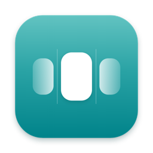

<p align="center">
  
</p>

<h1 align="center">Dylan</h1>

<p align="center">
  <strong>Dynamic Island untuk notch MacBook. Untuk semua orang, dengan kemampuan ekstra untuk developer.</strong>
</p>

<p align="center">
  <a href="https://github.com/ramdanegie/dylan/releases"></a>
  
  
  
  <a href="LICENSE"></a>
</p>

<p align="center">
  <a href="README.md">English</a> · Bahasa Indonesia
</p>

---

Dylan mengubah notch MacBook menjadi pusat status yang hidup. Musik, panggilan, notifikasi, baterai, meeting, screenshot, dan suhu muncul kecil di samping notch, melebar saat kursor mendekat, lalu menyingkir sendiri setelah selesai.

Ide terbaik dari app notch seperti Droppy, Atoll, DynamicLake, dan Alcove digabung dalam **satu app gratis dan open source**. Semuanya berjalan lokal, tanpa telemetry dan tanpa akun.

Developer mendapat **Mode Developer**: pantau agent AI, perintah yang lama, CI, dan dev server dari notch, dan jawab permintaan izin Claude Code tanpa pindah jendela. Pengguna lain tidak akan melihatnya sama sekali.

## Sorotan

- 🎵 **Musik yang terasa native.** Spotify, Apple Music, tab browser (YouTube, SoundCloud…) dan VLC. Lirik tersinkron dengan karaoke, romanisasi, dan terjemahan, pilihan output audio, volume per app, dan equalizer yang mengikuti audio sungguhan.
- 📸 **Screenshot tanpa ribet.** Area, jendela, layar penuh, scrolling capture, dan teks (OCR) dengan `⌥⇧1`–`⌥⇧4` dan `⌥⇧T`, plus rekam layar ke MP4 dengan `⌥⇧5`. Layar dibekukan dulu, loupe piksel menampilkan koordinat dan warna, lalu editor langsung terbuka: panah, kotak, teks, sorot, blur, nomor urut, crop. `⌘C` menyalin lalu menutup editor. Mode Studio menambahkan bingkai, gradien, bayangan, rasio media sosial, dan tata letak 3D.
- 🌡️ **Suhu & kipas.** Suhu CPU, GPU, SSD, dan baterai tanpa root. Preset kipas dari Senyap sampai Maksimal, kurva sendiri, `⌃⌥⇧0`–`4`, dan peringatan panas yang menyebut proses terberat. Kipas selalu kembali ke otomatis saat Dylan ditutup, sleep, atau crash.
- 🔔 **Notifikasi & panggilan.** Notifikasi app di notch dengan riwayat hari ini dan mode tenang saat Focus, balas dari banner, terima atau tolak panggilan, dan kontrol mic/kamera/share untuk Zoom, Teams, dan Meet.
- 🎧 **Discord.** Siapa yang sedang bicara di voice, mute, deafen, dan keluar dari notch.
- 🔋 **Perangkat.** HUD volume dan brightness, mik mati untuk semua app (`⌃⌥M`) dan mode pesawat (`⌃⌥⇧A`), animasi charging, baterai AirPods, indikator kamera dan mikrofon, status Focus.
- 🕌 **Waktu salat.** Jadwal Kemenag untuk kotamu, dihitung di Mac: hitung mundur di notch, tanggal Hijriah, dan azan (file audiomu sendiri) dengan musik dijeda.
- 🗓️ **Bantuan sehari-hari.** Countdown meeting dengan tombol Join, "waktunya berangkat" untuk meeting di lokasi fisik, reminder, Pomodoro dengan istirahat otomatis, stopwatch, flashcard, radio internet, shelf file dengan drop actions (kompres, AirDrop, iCloud Drive, bagikan), riwayat clipboard, color picker, keep awake, cuaca, progres download.
- 🧹 **Optimasi Penyimpanan.** Pindai cache, log, Downloads lama, file besar, dan cadangan iPhone (plus data Xcode dan `node_modules` lama di Mode Developer), lalu centang yang mau dihapus. Tiap item menampilkan ukuran, lokasi, dan dampaknya. Yang dibuat ulang otomatis dihapus; file milikmu dipindah ke Trash. Notch memberi tahu saat disk hampir penuh.
- 🙈 **Mode Presentasi.** Menyembunyikan isi sensitif saat share layar, dan bisa menyala sendiri ketika share dimulai.
- 🌏 **Bahasa Indonesia dan English**, mengikuti bahasa sistem atau pilihanmu.

### Untuk developer (Mode Developer)

- 🤖 **Agent AI.** Status langsung Claude Code (tool dan file yang sedang dikerjakan, baris `+x −y`, durasi), juga Codex CLI, Cursor, dan OpenCode. Jawab permintaan izin Claude Code langsung dari notch.
- ⏱️ **Command tracker.** `npm test`, build, migrasi, deploy: notch memberi tahu saat selesai atau gagal, lengkap dengan durasi dan exit code.
- 🧩 **Live Activity API.** Script apa pun bisa menampilkan progres di notch lewat CLI `dylan` (lihat di bawah).
- 🌐 **Port & dev server.** Port mana dipakai project apa, buka di browser, atau hentikan.
- ✅ **GitHub.** Status Actions untuk branch yang sedang dikerjakan, dan PR yang menunggu review-mu.
- 📋 **Clipboard developer.** Decode JWT, pretty-print JSON, Unix time ↔ tanggal, Base64, UUID, hash. Token dan password disamarkan dan tidak pernah ditulis ke disk.
- 📈 **Stats & peringatan** untuk CPU, memori, dan jaringan, dengan peringatan saat proses `node` atau `docker` yang nyangkut memakan CPU.
- 🛠️ Script widget, Docker, terminal cepat di notch (`⌃⌥T`), MCP server untuk Claude Code, dan Touch ID untuk `sudo`.

### Eksperimental (mati secara default)

- **Face Unlock.** Buka kunci dengan wajah memakai tantangan liveness acak dan batasan ala Apple. Ini bukan Face ID: kamera Mac hanya 2D. Baca [docs/face-unlock.md](docs/face-unlock.md) sebelum menyalakannya.
- **Widget lock screen** berisi jam, baterai, dan lagu yang sedang diputar.

## Instalasi

**Kebutuhan:** Mac Apple Silicon (M1 atau lebih baru) dan macOS 15 atau lebih baru.

1. Unduh `Dylan-x.y.z.dmg` terbaru dari [Releases](https://github.com/ramdanegie/dylan/releases).
2. Buka, lalu seret **Dylan** ke **Applications**.
3. Buka Dylan. Build uji belum dinotarisasi, jadi macOS tidak bisa memeriksanya: klik **Done**, lalu buka **System Settings → Privacy & Security** dan klik **Open Anyway**. (Atau jalankan `xattr -dr com.apple.quarantine /Applications/Dylan.app`.)

Dylan bisa memberi tahu saat ada versi baru (Settings → Tentang → Periksa pembaruan) dan menampilkan perubahan setelah tiap update; lihat [CHANGELOG.id.md](CHANGELOG.id.md).

Dylan ada di menu bar dan di notch. Izin (Screen Recording, Accessibility, Kalender…) hanya diminta saat kamu menyalakan fitur yang membutuhkannya.

## Live Activity API

```bash
dylan activity start deploy --title "Deploy staging" --progress 0
dylan activity update deploy --progress 0.6 --subtitle "migrasi DB"
dylan activity end deploy --success --detail "v2.4.1 · 3m 10s"

dylan run -- npm test            # jalankan perintah sebagai aktivitas, exit code diteruskan
dylan notify "Backup selesai" "12 GB"
```

Pasang CLI dari **Settings → Terminal → Pasang CLI** (symlink di `~/.local/bin/dylan`). Tambahkan `eval "$(dylan shell-init zsh)"` ke `~/.zshrc` supaya perintah yang lama terlacak otomatis. `dylan doctor` mengecek app, socket, hook, dan integrasi shell.

## Build dari source

Cukup Command Line Tools (tanpa Xcode).

```bash
git clone https://github.com/ramdanegie/dylan.git
cd dylan
./scripts/build.sh --test --run    # unit test, build/Dylan.app, lalu jalankan
```

- Secara default build ditandatangani ad-hoc, jadi macOS bisa meminta izin lagi setelah tiap build. Tandatangani dengan sertifikatmu sendiri supaya izin bertahan: `DYLAN_SIGN_IDENTITY="Apple Development: …" ./scripts/build.sh --run`. Kontrol kipas butuh build bertanda tangan tim.
- `./scripts/dmg.sh` membuat DMG seret-ke-Applications untuk penguji.
- `build/Dylan.app/Contents/MacOS/Dylan --snapshot <folder> --lang en|id` merender state notch ke PNG.

## Privasi

- Lokal: tanpa telemetry, analytics, akun, atau server.
- Akses jaringan opt-in per fitur: GitHub (lewat `gh`), cuaca, lirik, Spotify, tukar token Discord, waktu tempuh Apple Maps, dan cek update (Settings → Tentang; hanya mengambil daftar rilis).
- Fitur developer mati secara default dan tidak meminta izin apa pun sampai Mode Developer dinyalakan.
- CPU saat idle di bawah 1%.

## Struktur proyek

| Path | Isi |
|---|---|
| `Sources/Dylan` | App: notch, provider, Settings, screenshot (SwiftUI + AppKit) |
| `Sources/DylanCore` | Logika murni dengan unit test |
| `Sources/DylanCLI` | Command-line `dylan` |
| `Sources/DylanFanHelper`, `Sources/SMCKit` | Helper kipas (root) dan akses SMC |
| `Tests/DylanCoreTests` | Unit test (`swift test`) |
| `PRD.md`, `design/` | Spesifikasi produk dan mockup desain |

## Kontribusi

Issue dan pull request sangat diterima, dari laporan bug sampai aktivitas notch baru.

- Jalankan `./scripts/build.sh --test` sebelum membuka PR.
- Swift 6 dengan strict concurrency, SwiftPM, tanpa dependensi pihak ketiga.
- Setiap teks UI ada di `en.lproj` dan `id.lproj`; test memastikan kuncinya sama.
- Fitur baru yang eksperimental atau butuh banyak izin tetap mati secara default.

Kalau Dylan berguna buatmu, ⭐ membantu orang lain menemukannya.

## Pembuat

Dibuat oleh **Egie Ramdan** · [github.com/ramdanegie](https://github.com/ramdanegie)

## Lisensi

[MIT](LICENSE)
