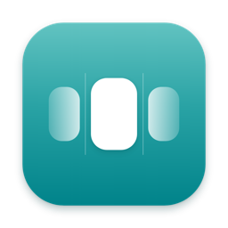

<p align="center">
  
</p>

<h1 align="center">Dylan</h1>

<p align="center">
  <strong>A Dynamic Island for your MacBook notch. For everyone, with superpowers for developers.</strong>
</p>

<p align="center">
  <a href="https://github.com/ramdanegie/dylan/releases"></a>
  
  
  
  <a href="LICENSE"></a>
</p>

<p align="center">
  English · <a href="README.id.md">Bahasa Indonesia</a>
</p>

---

Dylan turns the MacBook notch into a living status center. Music, calls, notifications, battery, meetings, screenshots, and temperatures show up small beside the notch, expand when you hover, and get out of the way when they are done.

It brings the best ideas from notch apps like Droppy, Atoll, DynamicLake, and Alcove into **one free, open-source app**. Everything runs locally, with no telemetry and no account.

Developers get a **Developer Mode** on top: watch AI coding agents, long-running commands, CI, and dev servers from the notch, and answer Claude Code permission prompts without switching windows. Everyone else never sees it.

## Highlights

- 🎵 **Music that feels native.** Spotify, Apple Music, browser tabs (YouTube, SoundCloud…) and VLC. Synced lyrics, audio output picker, per-app volume, and an equalizer that follows the actual audio.
- 📸 **Screenshots without the clutter.** Area, window, full screen, scrolling capture, and text (OCR) with `⌥⇧1`–`⌥⇧4` and `⌥⇧T`. The screen freezes first, a pixel loupe shows coordinates and colors, and the editor opens right away: arrows, boxes, text, highlight, blur, numbered steps, crop. `⌘C` copies and closes. A Studio mode adds frames, gradients, shadows, social ratios, and 3D layouts.
- 🌡️ **Temperatures & fans.** CPU, GPU, SSD, and battery temperatures without root. Fan presets from Quiet to Max, a custom curve, `⌃⌥⇧0`–`4`, and a heat warning that names the busiest process. Fans always go back to automatic when Dylan quits, sleeps, or crashes.
- 🔔 **Notifications & calls.** App notifications in the notch, reply from the banner, accept or decline calls, and mic/camera/share controls for Zoom, Teams, and Meet.
- 🎧 **Discord.** Who is talking in voice, mute, deafen, and leave from the notch.
- 🔋 **Devices.** Volume and brightness HUD, charging animation, AirPods battery, camera and microphone indicators, Focus status.
- 🗓️ **Everyday helpers.** Meeting countdown with a Join button, "time to leave" for in-person meetings, reminders, timer, a file shelf with AirDrop, clipboard history, color picker, keep awake, weather, download progress.
- 🙈 **Presentation Mode.** Hides sensitive content while you share your screen, and can turn on by itself when sharing starts.
- 🌏 **English and Bahasa Indonesia**, following your system language or your choice.

### For developers (Developer Mode)

- 🤖 **AI agents.** Live status for Claude Code (the tool and file it is working on, `+x −y` lines, duration), plus Codex CLI, Cursor, and OpenCode. Answer Claude Code permission requests straight from the notch.
- ⏱️ **Command tracker.** `npm test`, builds, migrations, deploys: the notch tells you when they finish or fail, with duration and exit code.
- 🧩 **Live Activity API.** Any script can show progress in the notch through the `dylan` CLI (see below).
- 🌐 **Ports & dev servers.** Which project owns which port, open it in the browser, or stop it.
- ✅ **GitHub.** Actions status for the branch you are on, and PRs waiting for your review.
- 📋 **Developer clipboard.** Decode JWTs, pretty-print JSON, Unix time ↔ date, Base64, UUIDs, hashes. Tokens and passwords are masked and never written to disk.
- 📈 **Stats & alerts** for CPU, memory, and network, with a warning when a stuck `node` or `docker` process eats the CPU.
- 🛠️ Script widgets, Docker, a quick terminal in the notch (`⌃⌥T`), an MCP server for Claude Code, and Touch ID for `sudo`.

### Experimental (off by default)

- **Face Unlock.** Unlock with your face using a random liveness challenge and Apple-style limits. It is not Face ID: a Mac camera is 2D. Read [docs/face-unlock.md](docs/face-unlock.md) before turning it on.
- **Lock screen widget** with the time, battery, and what is playing.

## Install

**Requirements:** a Mac with Apple Silicon (M1 or later) and macOS 15 or later.

1. Download the latest `Dylan-x.y.z.dmg` from [Releases](https://github.com/ramdanegie/dylan/releases).
2. Open it and drag **Dylan** to **Applications**.
3. Open Dylan. Test builds are not notarized yet, so macOS cannot verify it: click **Done**, then go to **System Settings → Privacy & Security** and click **Open Anyway**. (Or run `xattr -dr com.apple.quarantine /Applications/Dylan.app`.)

Dylan can tell you when a new version is out (Settings → About → Check for updates) and shows what changed after each update; see [CHANGELOG.md](CHANGELOG.md).

Dylan lives in the menu bar and the notch. Permissions (Screen Recording, Accessibility, Calendar…) are only asked for when you turn on a feature that needs them.

## Live Activity API

```bash
dylan activity start deploy --title "Deploy staging" --progress 0
dylan activity update deploy --progress 0.6 --subtitle "migrating DB"
dylan activity end deploy --success --detail "v2.4.1 · 3m 10s"

dylan run -- npm test            # run a command as a tracked activity, exit code passed through
dylan notify "Backup done" "12 GB"
```

Install the CLI from **Settings → Terminal → Install CLI** (symlink in `~/.local/bin/dylan`). Add `eval "$(dylan shell-init zsh)"` to `~/.zshrc` to track long commands automatically. `dylan doctor` checks the app, socket, hooks, and shell integration.

## Build from source

Only the Command Line Tools are needed (no Xcode).

```bash
git clone https://github.com/ramdanegie/dylan.git
cd dylan
./scripts/build.sh --test --run    # unit tests, build/Dylan.app, then launch
```

- Builds are signed ad-hoc by default, so macOS may ask for permissions again after each build. Sign with your own certificate to keep them: `DYLAN_SIGN_IDENTITY="Apple Development: …" ./scripts/build.sh --run`. Fan control needs a team-signed build.
- `./scripts/dmg.sh` packs a drag-to-Applications DMG for testers.
- `build/Dylan.app/Contents/MacOS/Dylan --snapshot <folder> --lang en|id` renders notch states to PNG.

## Privacy

- Local first: no telemetry, no analytics, no account, no server.
- Network access is opt-in per feature: GitHub (through `gh`), weather, lyrics, Spotify, Discord token exchange, Apple Maps travel time, and the update check (Settings → About; it only fetches the release list).
- Developer features are off by default and ask for nothing until you turn on Developer Mode.
- Idle CPU stays under 1%.

## Project layout

| Path | What is there |
|---|---|
| `Sources/Dylan` | The app: notch, providers, Settings, screenshots (SwiftUI + AppKit) |
| `Sources/DylanCore` | Pure logic with unit tests |
| `Sources/DylanCLI` | The `dylan` command-line tool |
| `Sources/DylanFanHelper`, `Sources/SMCKit` | Privileged fan helper and SMC access |
| `Tests/DylanCoreTests` | Unit tests (`swift test`) |
| `PRD.md`, `design/` | Product spec (in Indonesian) and design mockups |

## Contributing

Issues and pull requests are welcome, from bug reports to new notch activities.

- Run `./scripts/build.sh --test` before opening a PR.
- Swift 6 with strict concurrency, SwiftPM, no third-party dependencies.
- Every user-facing string lives in both `en.lproj` and `id.lproj`; a test checks that the keys match.
- New experimental or permission-hungry features stay off by default.

If Dylan is useful to you, a ⭐ helps other people find it.

## Author

Made by **Egie Ramdan** · [github.com/ramdanegie](https://github.com/ramdanegie)

## License

[MIT](LICENSE)
